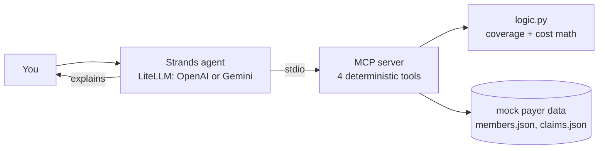

# agent-eligibility-claims

A healthcare agent that answers the questions every front desk and billing
team asks all day: *is this patient covered for this procedure, what's the
claim doing, and what will they owe?*

The boring part is the point. Eligibility rules, deductibles, coinsurance —
that math should not depend on how a language model happens to feel today.
So this agent is built the other way round: the model talks, and
deterministic code decides. The model figures out what the person is asking
for, the tools look it up in the mock payer data and do the arithmetic, and
the model explains the answer back in plain language. Nothing about coverage
or money is ever left to the model's imagination.

## What it does

Four tools, all of them deterministic, all of them served over MCP:

- `verify_eligibility` — member ID + procedure → covered or not, in-network
  or not, deductible remaining, copay, whether prior auth is required.
- `check_claim_status` — claim ID → paid / pending / denied / in review,
  with the adjudication detail (including the denial reason when there is one).
- `estimate_patient_cost` — member + procedure + billed amount → allowed
  amount, deductible applied, coinsurance, copay, what the patient owes, what
  the plan pays. Straight arithmetic: allowed is 80% of billed, deductible
  comes first, then coinsurance on what's left, plus the office-visit copay
  when one applies.
- `submit_claim` — submits a claim, but only with an explicit confirmation
  from the user, and only once per idempotency key. Submit the same claim
  twice with the same key and the second call is a no-op that returns the
  original claim ID.

Guardrails, baked into the system prompt: the agent looks things up and
explains them, it never approves a payment, and claim submission always
needs a human saying yes first. Member IDs are redacted from the logs.

## How it's put together



The agent is a single Strands agent running against a real model.
LiteLLM with `openai/gpt-4o-mini` is the default; pass
`--provider gemini` to run it on the Gemini free tier instead
(`gemini/gemini-3.5-flash-lite`, no card needed — see below). The tools
live in a separate MCP server process
(`agent_eligibility_claims.mcp_server`), which the agent connects to
over stdio when it starts up. The model never touches the payer data
directly — it can only call the tools, and the tools do the deciding.
The scripted model is only for the tests and the offline demo
(`make demo-mock`); the real path never falls back to it.

When the agent starts, it prints the tools it loaded, so you can see
exactly what it is allowed to call before it takes any request:

```
Loaded 4 tools from the MCP server:
  - verify_eligibility: Check whether a member's coverage is active and covers a procedure.
  - check_claim_status: Look up a claim by ID and return its status and adjudication detail.
  - estimate_patient_cost: Estimate what a member will owe for a procedure before it happens.
  - submit_claim: Submit a claim to the payer. Idempotent and requires confirmation.
```

## Quickstart

```bash
python3 -m venv .venv
.venv/bin/pip install -e ".[dev]"
cp .env.example .env   # then put your OpenAI key in .env
make demo              # real agent, LiteLLM openai/gpt-4o-mini
```

The demo runs against real OpenAI by default — a real model doing real
tool calls against the MCP server. It needs `OPENAI_API_KEY`, either in
your environment or in a `.env` file in the repo root. No key, no silent
fallback: the demo stops with a clear message telling you to set one.
Never commit a real key: `.env` is gitignored, and `.env.example` is the
only key-shaped file in the repo.

## Web UI (run it locally)

The same agent, in your browser: ask a coverage, claim-status, or
cost question and watch it call the four MCP tools — every tool
call is shown with its inputs and result. Runs on your own machine:

```bash
pip install -r web/requirements.txt
uvicorn web.app:app --reload        # http://127.0.0.1:8000
# or simply: make web
```

Mock mode by default (the scripted model — deterministic, no key,
no network). Set `GEMINI_API_KEY` in your environment to run the
agent live on the Gemini free tier instead; the page shows which
mode answered. Claim submission still asks for an explicit
confirmation in the UI before anything is submitted, and the same
idempotency key twice returns the original claim. Details:
[`web/README.md`](web/README.md).

## Running it free on Gemini

Don't want to pay OpenAI for the demo? Run the same agent on Google's
free tier instead:

```bash
make demo-gemini   # or: python -m agent_eligibility_claims.demo --provider gemini
```

It needs `GEMINI_API_KEY` — get a free key at Google AI Studio
(https://aistudio.google.com), no credit card and no billing account.
The model is `gemini-3.5-flash-lite`, picked for the free tier on
purpose: it is stable and new projects can use it, and its free daily
quota (about 500 requests/day as shown in AI Studio) is far higher than
plain Flash (about 20/day) — the demo makes several calls per run, so
Flash would run out after a couple of runs. It is also the model
`gemini-2.5-flash` routes to after that ID stops serving new users on
December 1, 2026, so it will not disappear under you next month.

Two things to know about the free tier: the limits are per project, not
per key, and Google says free-tier content may be used to improve its
products. Model names rotate fast — if the ID ever stops working,
check Google's Gemini API pricing page for the current free-tier
Flash-Lite model and swap the one line in `agent.py`
(`PROVIDERS["gemini"]["model_id"]`).

It walks through six scenarios against the mock data. The model words
things its own way, so your output won't match this word for word — but
the tool calls and the verdicts are deterministic, so the answers are
the same:

```
### 1. Eligibility check that passes
You: Check eligibility for member MBR-1001 for procedure 99213.
Agent: Member MBR-1001 is eligible for 99213 (Office visit, established
patient, 15 min): active Acme Health PPO Gold, in-network, $0.0 deductible
remaining, $25.0 copay. Prior authorization required: no.

### 2. Eligibility check that fails (terminated coverage)
You: Check eligibility for member MBR-1003 for procedure 70553.
Agent: Member MBR-1003 is NOT eligible for 70553: Coverage is terminated
as of 2026-09-30. Employment ended; COBRA not elected

### 3. Claim status lookup (denied claim)
You: What is the status of claim CLM-9003?
Agent: Claim CLM-9003 is denied. Billed $1800.0. Denial reason: Prior
authorization required but not obtained (CARC 197).

### 4. Patient cost estimate
You: Estimate the patient cost for member MBR-1002, procedure 70553,
billed $2400.00.
Agent: Estimated patient cost for 70553: $1344.0 (allowed $1920.0 on
$2400.0 billed; deductible $1200.0, coinsurance $144.0, copay $0.0).
The plan pays $576.0.

### 5a. Submit a claim (confirmed)
Agent: Claim submitted: CLM-9101, status submitted.

### 5b. Submit the same claim again (same idempotency key)
Agent: Already submitted — this idempotency key was used before, so no
new claim was created. Original claim: CLM-9101 (status submitted).
```

## The mock data

Everything is synthetic — no real patient information anywhere in this
repo. Four members, each in a different coverage state:

| Member | Plan | State |
| --- | --- | --- |
| MBR-1001 — Asha Sharma | Acme Health PPO Gold | Active, deductible met |
| MBR-1002 — Jay Patel | Acme Health PPO Silver | Active, $1,200 deductible left |
| MBR-1003 — Ravi Iyer | Acme Health PPO Gold | Terminated 2026-09-30 |
| MBR-1004 — Sita Rao | Acme Health HMO | Active, in-network only |

And four claims in four states: CLM-9001 paid, CLM-9002 pending,
CLM-9003 denied (prior auth, CARC 197), CLM-9004 in review. The data
lives in `src/agent_eligibility_claims/data/members.json` and
`claims.json` — edit those files to try different scenarios.

## Using the MCP server from any client

The tools aren't locked to this agent. The server is a plain MCP server
(MCP Python SDK), so anything that speaks MCP — Claude Code, other agent
frameworks, an MCP inspector — can use the same four tools:

```bash
# Start it standalone (stdio transport):
.venv/bin/python -m agent_eligibility_claims.mcp_server
```

Point your MCP client at that command with stdio transport. The server
exposes exactly four tools — `verify_eligibility`, `check_claim_status`,
`estimate_patient_cost`, `submit_claim` — with JSON schemas generated
from their function signatures. The agent in this repo connects the same
way: it spawns the server as a subprocess and talks to it through
Strands' `MCPClient` (`strands.tools.mcp.MCPClient`).

One thing to know: the server keeps its claim ledger in memory, so
submitted claims (and their idempotency keys) only live as long as the
server process does. Restart it and the ledger resets to the four seed
claims.

## Running it offline (mock)

The tests and the offline demo use a scripted model — deterministic,
free, no network — so they never need a key:

```bash
make demo-mock   # or: python -m agent_eligibility_claims.demo --mock
make test        # the full suite runs offline
```

The scripted model is a stand-in, not the agent: it reads the request,
makes the one tool call the request needs, and summarizes the tool
result. It exists so the orchestration (which tool, in what order, what
happens on a repeat submit) is testable without spending anything. The
real agent — the thing `make demo` and `make demo-gemini` run — is
always a real model, OpenAI or Gemini.

## Running the tests

```bash
make test   # or: .venv/bin/python -m pytest -v
```

41 tests, no key needed (43 collected; the two live ones skip without a key):

- `tests/test_logic.py` — the deterministic logic directly: eligibility
  verdicts, claim statuses, the cost math, idempotency, the confirmation
  gate.
- `tests/test_mcp_tools.py` — the tools called over the real MCP protocol
  through a client, including a test that the agent loads exactly the four
  expected tools.
- `tests/test_orchestration.py` — the full agent with the scripted model:
  the five demo scenarios end to end, including submitting the same claim
  twice.
- `tests/test_agent_factory.py` — the default agent demands its
  provider's key and fails clearly without one; the Gemini path builds
  `gemini/gemini-3.5-flash-lite` and a Gemini key does not unlock the
  OpenAI path; `.env` loading; the scripted model needs no key.
- `tests/test_demo_cli.py` — `demo` without a key fails with a clear
  message; `demo --provider gemini` and `demo --gemini` fail clearly
  without a Gemini key; `demo --mock` runs the whole demo offline.
- `tests/test_live.py` — one smoke test per provider. The OpenAI one
  only runs when `OPENAI_API_KEY` is set; the Gemini one only runs when
  `GEMINI_API_KEY` is set. Both skip otherwise.

## Layout

```
src/agent_eligibility_claims/
  prompts.py          all system prompts, as named constants (inspectable)
  agent.py            EligibilityAgent (Strands), MCP client, tool listing
  mcp_server.py       the MCP server (the four tools)
  logic.py            the deterministic rules — no model, no network
  scripted_model.py   rule-based stand-in model for tests and the offline demo
  demo.py             the six-scenario demo CLI
  data/               mock members + claims (synthetic)
tests/
  test_logic.py  test_mcp_tools.py  test_orchestration.py  test_live.py
```

## Why this exists

Healthcare eligibility and claims are a good test of whether an agent
architecture is actually trustworthy: the stakes are real money and real
people's coverage, and a confident wrong answer is worse than no answer.
The pattern here — model talks, code decides, every money-moving action
needs a human yes and an idempotency key — is the one I'd want in front
of a real payer system. This repo is the mock-data version of that
pattern, runnable in one command against a real model.
